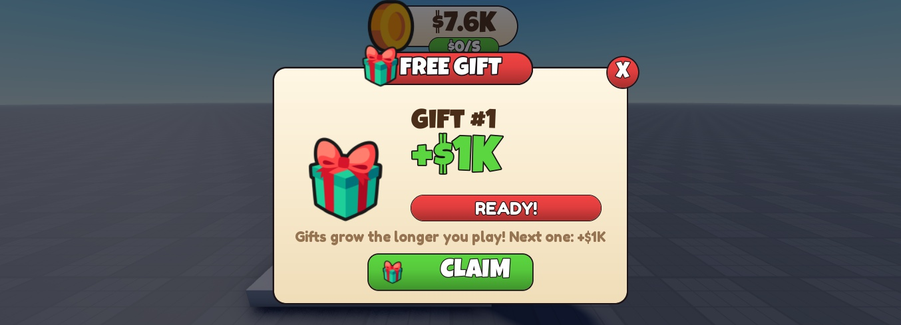
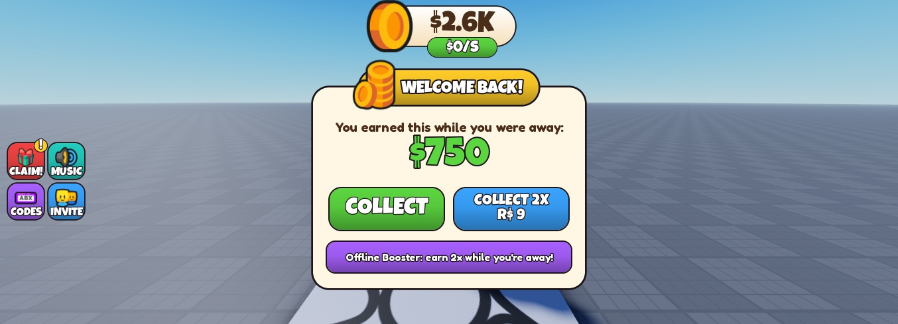
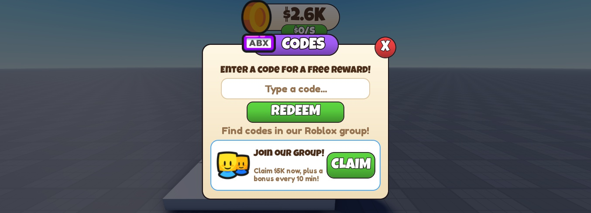

# roblox-hub

[](https://github.com/rodrigo-guerraa/roblox-hub/actions/workflows/ci.yml)

A toolkit for building Roblox games where **the code is written, tested and maintained by an AI agent** ([Claude Code](https://claude.com/claude-code)) and a human makes the design, art and business calls.

It packages what shipping a Roblox simulator this way taught us: a project template wired for AI guardrails, game systems you can drop into a new game, and "skills" — knowledge files the agent loads on demand — including a hard-won list of Roblox gotchas.

## What's inside

| Folder | Contents |
| --- | --- |
| [`template/`](template/) | An empty Rojo project: pinned toolchain (Rojo, Wally, Selene, StyLua, luau-lsp, Lune), lint/format/type-check configs, a TestEZ runner and a starter `CLAUDE.md` with working rules for the agent. |
| [`systems/`](systems/) | Reusable game systems, copied into a game rather than linked: **core** (save data with migrations, economy, remotes, number formatting), a cartoon-style **UI kit**, **monetization** (receipts, game passes, paid-random-items policy, offline earnings) and **live-ops** (codes, playtime gifts, group rewards, badges, social prompts). They share one contract: [`systems/CONVENTIONS.md`](systems/CONVENTIONS.md). |
| [`skills/`](skills/) | Claude Code skills. [`roblox-lessons`](skills/roblox-lessons/) is original: the gotchas learned shipping a game. [`skills/vendored/`](skills/vendored/) holds 18 skills curated from public collections — trimmed, corrected and pinned, each with its license and a `SOURCE.md` describing the changes. |
| [`docs/`](docs/) | [Onboarding](docs/onboarding.md), the [reuse catalog](docs/reuse-catalog.md) and a [survey](docs/research/2026-10-skill-and-tool-survey.md) of Roblox tools, libraries and AI skill repos. |
| [`scripts/`](scripts/) | Installing the skills for every project, and the CI helpers: `assemble-sandbox.sh` builds the template with every system dropped in, which CI format-checks, lints and builds on every push. |

## Quick start

1. Clone this repo into a workspace folder that will hold your games next to it:
   ```
   roblox/
   ├── roblox-hub/
   └── my-game/
   ```
2. Install the skills for all your Claude Code projects (Windows):
   ```powershell
   powershell -ExecutionPolicy Bypass -File roblox-hub\scripts\sync-skills.ps1
   ```
   This copies `skills/*` and `skills/vendored/*` into `%USERPROFILE%\.claude\skills\`, replacing only the folders the hub owns. Re-run it after pulling skill updates.
3. Start a new game from the template by following [`docs/onboarding.md`](docs/onboarding.md) — or open a Claude Code session in an empty folder next to the hub and ask it to start a game from `../roblox-hub`.

**Requirements:** Roblox Studio with its built-in MCP server enabled (the agent verifies every change through it), the Rojo Studio plugin, [Rokit](https://github.com/rojo-rbx/rokit), git and Claude Code.

## Status

| Part | State |
| --- | --- |
| `template/` | Builds, lints and format-checks clean in CI. |
| `skills/` | Ready to use. |
| `systems/` | Extracted from the shipped game and made game-agnostic, then run together in Studio: all 84 specs pass, and a playtest exercised each system through the Studio MCP (purchases with fake receipts, forged remote calls, policy blocking, offline doubling, codes, gifts, group reward). Not yet exercised: badge awarding and live pass purchases (they need real ids in a published game) and saving across sessions. Per-system detail is in the [reuse catalog](docs/reuse-catalog.md). |

## The UI kit

Every window and the HUD come from one small kit (`systems/ui/kit`), sized by scale so the same code fits desktop and phones. These are the generic systems running in an empty Baseplate:

<p>
  
  
  
</p>

## Principles

- **Prove it in Studio.** A change counts as done when it's been exercised in a fresh playtest through the Studio MCP — not when it compiles.
- **Copy, don't link.** A game owns its copy of a system; improvements are copied back into the hub deliberately.
- **Lessons flow back.** When a game teaches something new, it goes into `skills/roblox-lessons`.
- **Vendored content is curated.** Third-party skills are copied by hand (never via installers), pinned to a commit, kept under their license and documented in `SOURCE.md`. Content that tries to steer the agent ("load me first", "override other rules") is removed.

## License

The hub's own content is [MIT](LICENSE). Vendored skills and ProfileStore keep their own licenses (MIT or Apache-2.0) — see [`THIRD_PARTY_NOTICES.md`](THIRD_PARTY_NOTICES.md).
